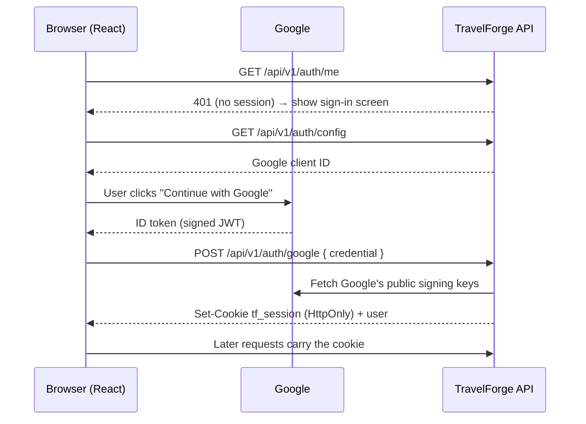

# Authentication (Sign in with Google)

Updated: 2026-11-14

TravelForge signs travelers in with their Google account. The app is gated: nobody sees the planning screen until they are signed in. There are no TravelForge passwords.

## One-time setup

Sign-in does not work until you create a Google OAuth client ID and give it to the backend.

1. Open [Google Cloud Console → Google Auth Platform](https://console.cloud.google.com/auth/overview) and pick or create a project.
2. Under **Branding**, fill in the app name and support email. Under **Audience**, choose **External**. While the app is in **Testing**, add each Google account that needs to sign in as a **test user**.
3. Under **Clients**, create a client of type **Web application**.
4. Under **Authorized JavaScript origins**, add all three:
   - `http://localhost:5173`
   - `http://localhost`
   - `http://127.0.0.1:5173`
5. Leave **Authorized redirect URIs** empty. This flow does not use a redirect.
6. Copy the client ID (it ends in `.apps.googleusercontent.com`). You do not need the client secret.
7. Put it in `backend/.env` (copy `backend/.env.example` if the file does not exist):

   ```dotenv
   GOOGLE_OAUTH_CLIENT_ID=1234567890-abc.apps.googleusercontent.com
   APP_SECRET_KEY=<at least 32 random characters>
   ```

   Generate a secret with `python3 -c "import secrets; print(secrets.token_urlsafe(48))"`.
8. Restart the backend. Environment changes are not picked up by `--reload`.

`GOOGLE_OAUTH_CLIENT_ID` is not the Gemini `GOOGLE_API_KEY`. They are different credentials.

Origin changes in Google Cloud Console can take a few minutes to apply. Open the app at the same origin you registered, for example `http://localhost:5173`.

## Run it

Both servers must be running. Commands are in [COMMANDS.md](COMMANDS.md).

- Backend: `http://127.0.0.1:8000`
- Frontend: `http://localhost:5173`. The Vite dev server forwards `/api` to the backend.

## How sign-in works



1. The frontend loads Google Identity Services and shows Google's button.
2. Google returns an **ID token** to the page after the traveler picks an account.
3. The frontend posts that token to the backend. The backend never trusts the browser's claim about who the user is. It checks the token's signature against Google's public keys, and checks the issuer, the audience (our client ID), the expiry, and that the email is verified.
4. The backend then issues its own session: a signed JWT (HS256, signed with `APP_SECRET_KEY`) stored in the `tf_session` cookie.
5. Protected routes read the cookie through the `CurrentUser` dependency.

## API

Base path: `/api/v1/auth`

| Method | Path | Purpose | Responses |
|---|---|---|---|
| `GET` | `/config` | Public sign-in settings (the Google client ID) | `200` |
| `POST` | `/google` | Verify a Google ID token and start a session. Body: `{"credential": "<ID token>"}` | `200` user + cookie · `401` token not valid · `403` wrong origin · `503` not configured, or Google unreachable |
| `GET` | `/me` | The signed-in user | `200` user · `401` no valid session |
| `POST` | `/logout` | End the session | `204` · `403` wrong origin |

User shape:

```json
{ "id": "google-account-id", "email": "traveler@example.com", "name": "Test Traveler", "picture": "https://…" }
```

`id` is Google's `sub` claim. It is stable for an account and is the value to key the future `users` table on. Do not key on email, which can change.

## Protecting a new route

```python
from app.api.deps import CurrentUser

@router.get("/trips")
def list_trips(user: CurrentUser) -> list[Trip]:
    return trip_service.list_for_user(user.id)
```

A request without a valid session gets `401` before the handler runs. Add `dependencies=[Depends(require_trusted_origin)]` to routes that change data.

In the frontend, `useAuth()` from `src/auth/AuthContext.tsx` returns `user`, `status`, and `signOut`. Requests to `/api/...` send the cookie automatically because they are same-origin.

## Configuration

| Variable | Required | Default | Purpose |
|---|---|---|---|
| `GOOGLE_OAUTH_CLIENT_ID` | Yes | empty | Web client ID. Sign-in returns `503` while it is empty. |
| `APP_SECRET_KEY` | In production | temporary key in development | Signs session cookies. At least 32 characters. Without it, development sessions end when the server restarts. Production refuses to start. |
| `APP_ENV` | No | `development` | `production` marks the cookie `Secure` (HTTPS only). |
| `FRONTEND_ORIGIN` | No | `http://localhost:5173,http://127.0.0.1:5173` | Comma-separated origins allowed to sign in and out. |
| `SESSION_TTL_SECONDS` | No | `604800` (7 days) | Session lifetime. |

## Security decisions

- **HttpOnly cookie, not `localStorage`.** Page scripts cannot read the session, so an injected script cannot steal it.
- **`SameSite=Lax` plus an `Origin` check.** Other sites cannot send the cookie on a POST, and `POST /google` and `POST /logout` reject a browser `Origin` that is not in `FRONTEND_ORIGIN`. This also stops another site from signing a visitor into an attacker's account.
- **Server-side verification with Google's library** (`google-auth`), not hand-rolled JWT parsing.
- **Verified email required.** Unverified Google emails are rejected.
- **Session algorithm is pinned to HS256**, so a token that names another algorithm or `none` is rejected.
- **Minimum data.** Only Google's account id, name, email, and photo URL are used. Nothing is stored on the server yet.

## Where the code is

| File | Role |
|---|---|
| `backend/app/core/config.py` | Reads settings from the environment |
| `backend/app/core/security.py` | Google token verification; session token create/read |
| `backend/app/api/deps.py` | `CurrentUser` and `require_trusted_origin` dependencies |
| `backend/app/api/routes/auth.py` | The four endpoints |
| `backend/app/models/auth.py` | Request and response models |
| `backend/tests/unit/test_auth.py` | Route tests with Google verification stubbed |
| `frontend/src/auth/AuthContext.tsx` | Session state, `useAuth()`, sign-in and sign-out calls |
| `frontend/src/auth/SignIn.tsx` | Sign-in screen and Google button |
| `frontend/src/main.tsx` | Shows `SignIn` or `App` depending on the session |
| `frontend/vite.config.ts` | Dev proxy from `/api` to the backend |

## Current limits

- **No user records.** There is no database yet, so users are not saved. The session cookie carries the profile. When the `users` table exists, create or update the row in `POST /google`.
- **No server-side revocation.** Sign-out clears the cookie in that browser. A copied cookie stays valid until it expires. Revoking sessions needs a session store or a per-user token version.
- **No refresh.** A session lasts `SESSION_TTL_SECONDS`, then the traveler signs in again. Profile changes at Google show up at the next sign-in.
- **Production needs one origin.** The cookie setup assumes the frontend and `/api` are served from the same origin (for example behind one reverse proxy), over HTTPS. Add the production origin to Google Cloud Console and to `FRONTEND_ORIGIN`.
- **Any Google account can sign in** once the OAuth app is published. There is no allowlist.

## Troubleshooting

| What you see | Cause and fix |
|---|---|
| "Can’t reach the TravelForge API" | The backend is not running on port 8000. Start it. |
| "Google sign-in isn’t set up yet" | `GOOGLE_OAUTH_CLIENT_ID` is empty. Set it in `backend/.env` and restart the backend. |
| Google button missing, or console says the origin is not allowed | The page's origin is not in **Authorized JavaScript origins**. Add it, wait a few minutes, and reload. |
| Google shows "Access blocked" (`403: access_denied`) | The OAuth app is in Testing and this account is not a test user. Add it under **Audience**. |
| "Google sign-in could not be verified" (`401`) | The token's audience does not match `GOOGLE_OAUTH_CLIENT_ID`, or the machine clock is wrong. |
| "Request origin is not allowed" (`403`) | The page's origin is not in `FRONTEND_ORIGIN`. |
| Signed out after every backend restart | `APP_SECRET_KEY` is empty or shorter than 32 characters. |

## References

- [Google Identity Services: Sign in with Google for Web](https://developers.google.com/identity/gsi/web/guides/overview)
- [Verify the Google ID token on your server side](https://developers.google.com/identity/gsi/web/guides/verify-google-id-token)
- [OWASP Session Management Cheat Sheet](https://cheatsheetseries.owasp.org/cheatsheets/Session_Management_Cheat_Sheet.html)
- [FastAPI: Dependencies](https://fastapi.tiangolo.com/tutorial/dependencies/)
